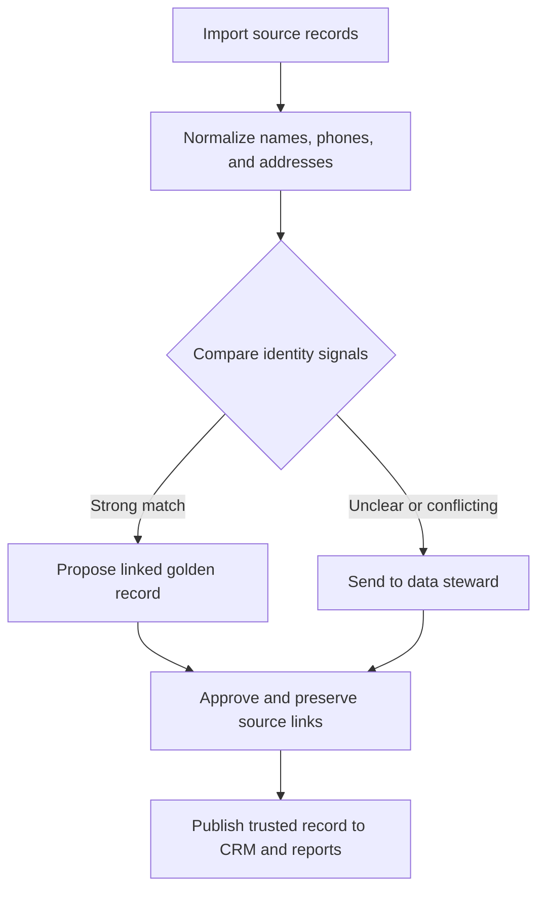

# Master Data Management case study

A fictional CRM migration scenario showing how duplicate customer records can be reviewed, standardized, and linked to a trusted customer identity.

## Example records

| Source | Customer | Phone | Email | City |
| --- | --- | --- | --- | --- |
| CRM A | Green Valley Traders | 01700-000101 | accounts@example.test | Dhaka |
| CRM B | Green Vly Traders | 01700-000101 | accounts@example.test | DHAKA |
| Legacy sheet | Green Valley Trade | 01700-000119 | blank | Dhaka |

These examples are synthetic. Similar names alone should not trigger an automatic merge.

## Review flow

## Matching and stewardship rules

- Normalize phone numbers, whitespace, case, and common abbreviations while retaining each source value for audit.
- Combine exact phone or verified email matches with name and location similarity.
- Treat conflicting phone numbers or ownership as a human review case.
- Store the selected golden value with its source, reviewer, and effective date.
- Keep source record identifiers so integrations can trace updates back to their origin.

## Migration checks

| Check | Expected result |
| --- | --- |
| Repeated exact phone and email | Candidate pair appears for review with evidence. |
| Shared company name but different phone and email | Records remain separate until a steward confirms the relationship. |
| Approved merge | Golden customer links to both source IDs and retains a change history. |
| Downstream export | One approved customer identity is sent, with required fields and stable key. |

A production implementation should define ownership, consent and retention rules, match thresholds, exception handling, and rollback before a migration begins. No real customer information is included.
